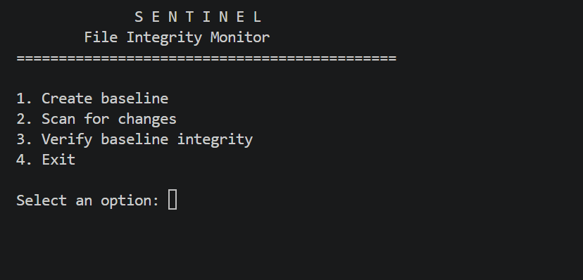
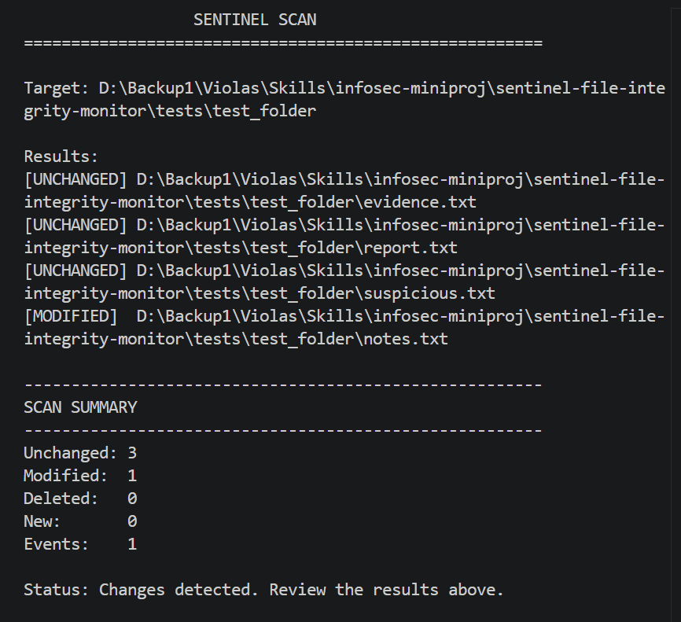
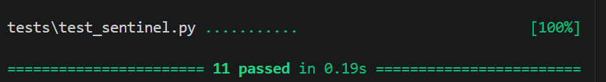

# Sentinel - File Integrity Monitoring Tool

Sentinel is a Python-based file integrity monitoring tool designed to detect
unauthorized or unexpected changes to files.

The project uses SHA-256 cryptographic hashing to establish a trusted baseline
of files and compare that baseline against subsequent scans.

## Features

- SHA-256 file hashing
- Trusted file baseline creation
- File modification detection
- New file detection
- Deleted file detection
- Baseline integrity verification
- Security event logging
- Interactive command-line interface
- Automated tests using pytest
- Error handling for missing and corrupted baseline files

## How It Works

Sentinel follows a simple integrity-monitoring process:

1. A baseline is created from the files in the monitored directory.
2. SHA-256 hashes are calculated for each file.
3. The hashes are stored in a baseline file.
4. A cryptographic hash of the baseline itself is also stored.
5. During subsequent scans, Sentinel calculates new file hashes.
6. The new hashes are compared with the trusted baseline.
7. Sentinel reports files that are modified, deleted, or newly created.

### Basic Workflow

    Files
       |
       v
    SHA-256
       |
       v
    Trusted Baseline
       |
       v
    Future Scan
       |
       v
    Hash Comparison
       |
       +---- Unchanged
       |
       +---- Modified
       |
       +---- Deleted
       |
       +---- New File

## Requirements

- Python 3.10 or later
- pytest

## Installation

Clone the repository:

    git clone <repository-url>

Navigate into the project:

    cd sentinel-file-integrity-monitor

Install pytest:

    python -m pip install pytest

## Usage

### Interactive Mode

Run:

    python sentinel.py

Sentinel will display an interactive menu.

### Create a Baseline

    python sentinel.py baseline

### Scan for Changes

    python sentinel.py scan

### Verify Baseline Integrity

    python sentinel.py verify

## Testing

Run the automated test suite with:

    python -m pytest

The test suite covers:

- Hash consistency
- Hash changes after file modification
- Unchanged files
- Modified files
- Deleted files
- New files
- Baseline integrity
- Baseline tampering
- Missing baseline integrity data
- Corrupted baseline files

## Security Concepts Demonstrated

### Cryptographic Hashing

Sentinel uses SHA-256 to generate a unique hash value representing the
contents of a file.

If the contents change, the resulting hash should also change.

### File Integrity Monitoring

The tool compares the current state of monitored files against a trusted
baseline to identify unexpected changes.

### Baseline Integrity

The baseline itself is protected by storing its SHA-256 hash separately.
Sentinel verifies this hash before trusting the baseline during a scan.

### Logging and Auditing

Detected security events are recorded in the Sentinel log, providing an
audit trail that can be reviewed later.

## Project Structure

    sentinel-file-integrity-monitor/
    |
    +-- sentinel.py
    +-- README.md
    +-- .gitignore
    |
    +-- data/
    |   +-- baseline.json
    |   +-- baseline.hash
    |
    +-- logs/
    |   +-- sentinel.log
    |
    +-- tests/
        +-- test_sentinel.py
        +-- test_folder/

Generated baseline and log files are excluded from version control.

## Demonstration

### Sentinel Interface

### File Integrity Detection

### Automated Tests

## Limitations

Sentinel is an educational file integrity monitoring project and is not
intended to replace enterprise security monitoring solutions.

The baseline and its integrity hash are stored locally. An attacker who gains
sufficient access to the system could potentially modify both.

The tool currently performs scans on demand rather than continuously
monitoring the filesystem.

## Future Improvements

Possible future improvements include:

- Continuous filesystem monitoring
- Digital signatures for baseline protection
- Configuration files
- More detailed forensic reports
- Email or notification alerts
- Web-based dashboard
- Database-backed event storage
- File metadata collection
- Improved access control

## Author

Viola Kania

Information Security and Forensics Student
